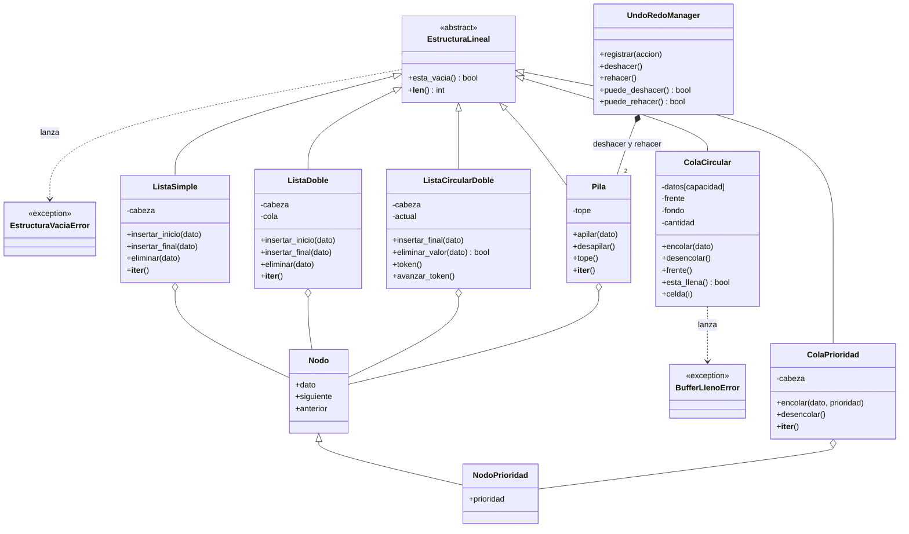
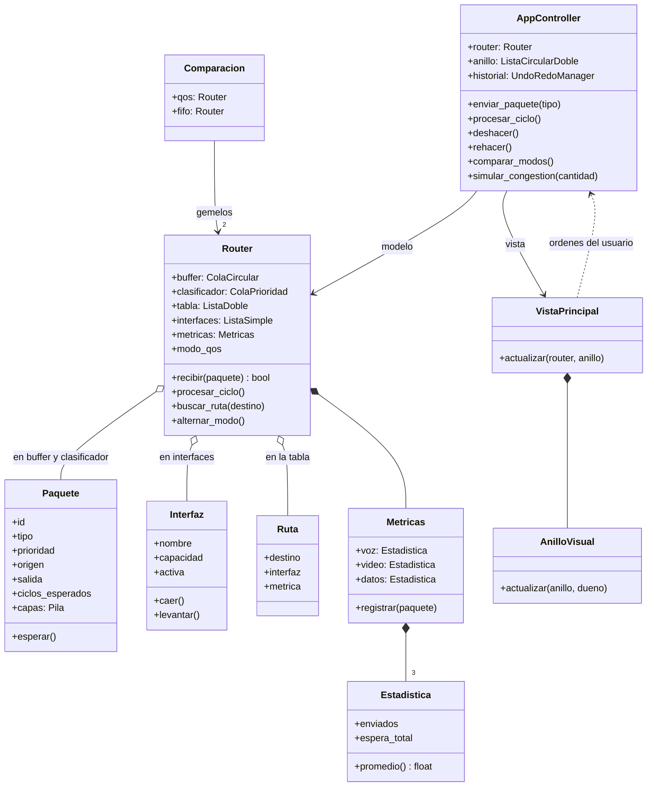

# Documentación técnica — Simulador de Red con QoS

## 1. Diagrama de clases: estructuras de datos

## 2. Diagrama de clases: dominio y MVC

**Regla MVC:** el modelo (`Router`, estructuras) no conoce Flet; la vista
(`VistaPrincipal`) no importa el modelo. Solo el `AppController` conoce a los
dos.

## 3. Tabla de complejidad temporal

n = cantidad de elementos de la estructura.

| Estructura | Operación | Complejidad | Por qué |
|---|---|---|---|
| ListaSimple | insertar_inicio | **O(1)** | El nuevo nodo apunta a la cabeza |
| ListaSimple | insertar_final | **O(n)** | Recorre hasta el último nodo |
| ListaSimple | buscar / eliminar | O(n) | Recorre nodo por nodo |
| ListaDoble | insertar_inicio | O(1) | Usa la cabeza |
| ListaDoble | insertar_final | **O(1)** | Usa el puntero `cola` |
| ListaDoble | buscar / eliminar | O(n) | Recorre; al borrar reconecta 2 punteros |
| ListaCircularDoble | insertar_final | O(1) | El último es `cabeza.anterior` |
| ListaCircularDoble | avanzar_token / token | O(1) | Mueve o lee el puntero `actual` |
| ListaCircularDoble | eliminar_valor | O(n) | Recorre la vuelta completa |
| Pila | apilar / desapilar / tope | O(1) | Todo ocurre en el tope |
| UndoRedoManager | deshacer / rehacer | O(1) | Pasa un elemento de una pila a otra |
| ColaPrioridad | encolar | **O(n)** | Recorre hasta su lugar según prioridad |
| ColaPrioridad | desencolar | **O(1)** | Siempre saca la cabeza |
| ColaCircular | encolar / desencolar | O(1) | Índices con `% capacidad` |
| ColaCircular | celda(i) / frente | O(1) | Acceso directo al arreglo |
| Router | buscar_ruta | O(r) | Recorre la tabla de r rutas |
| Router | procesar_ciclo | O(b · n) | Clasifica b paquetes del buffer, cada uno O(n) en la cola de prioridad |

**Complejidad espacial:** todas las estructuras enlazadas ocupan O(n), un nodo
por elemento. La ColaCircular ocupa O(capacidad) fija desde el inicio: es la
única que usa un arreglo, porque un buffer de router tiene tamaño fijo y
necesita acceso O(1) por índice.

## 4. Verificación empírica (O(1) vs O(n))

Medido con `medicion_complejidad.py`, tiempo total en ms:

| n | ListaSimple.insertar_inicio | ListaSimple.insertar_final | ListaDoble.insertar_final |
|---|---|---|---|
| 1 000 | 0.8 | 14.7 | 0.3 |
| 10 000 | 9.7 | 1210.1 | 3.0 |

Al multiplicar n por 10, las operaciones O(1) tardan unas 10 veces más en
total (crecimiento lineal), mientras que `insertar_final` de la lista simple
tarda unas 82 veces más (crecimiento cuadrático: O(n) por cada inserción).

## 5. Pruebas

101 pruebas unitarias con `unittest` (`python -m unittest discover tests`):
casos límite de cada estructura (vacía, un elemento, llena), motor de red,
controlador, historial, token, métricas, comparador y congestión.