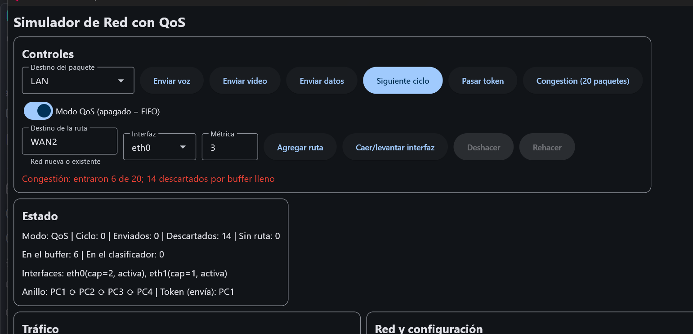
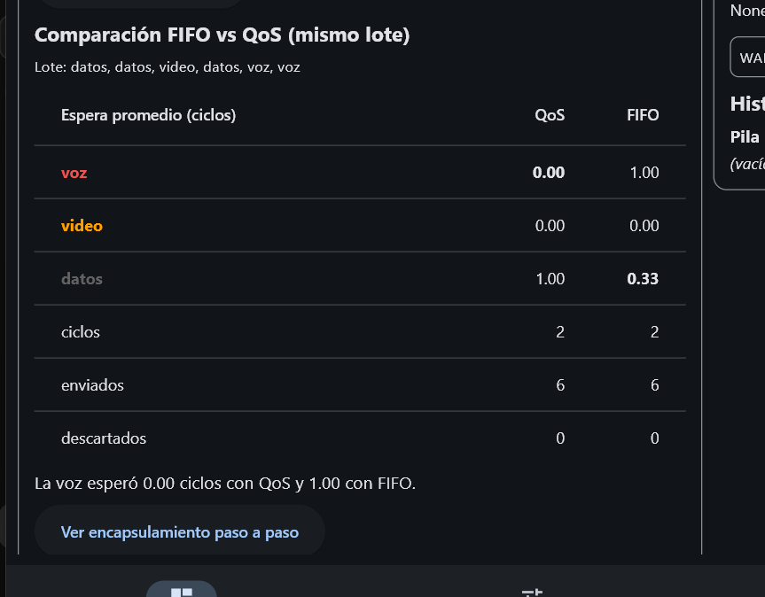
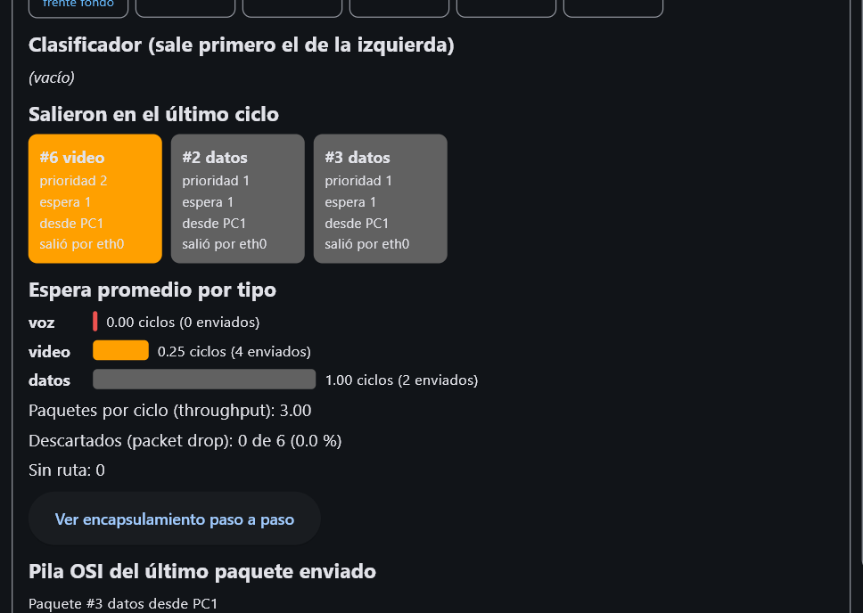
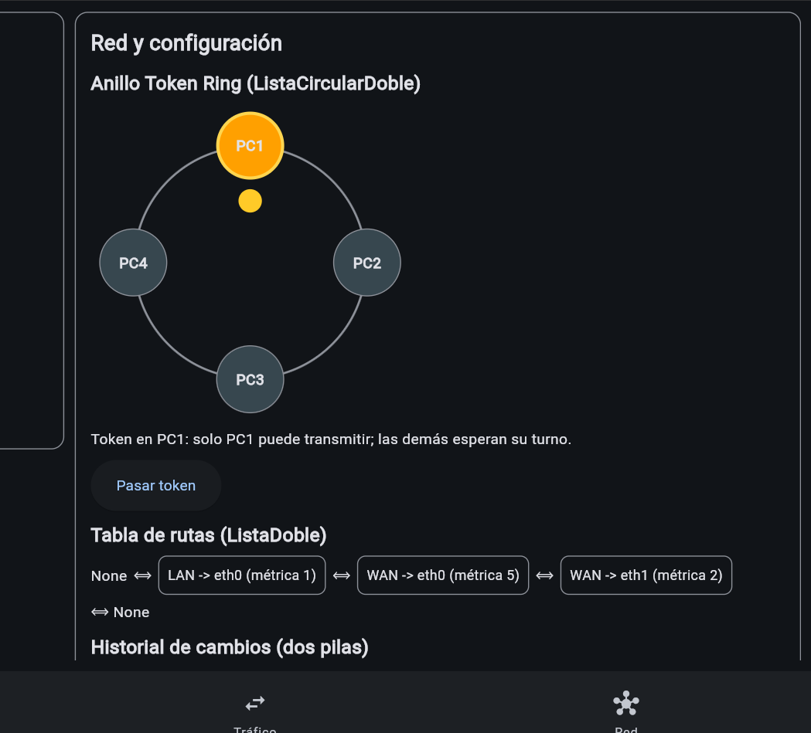
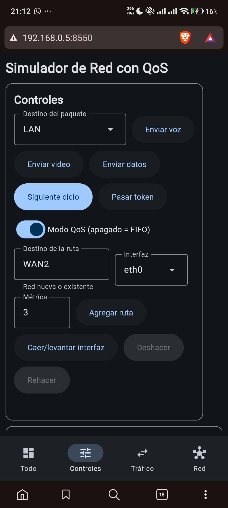
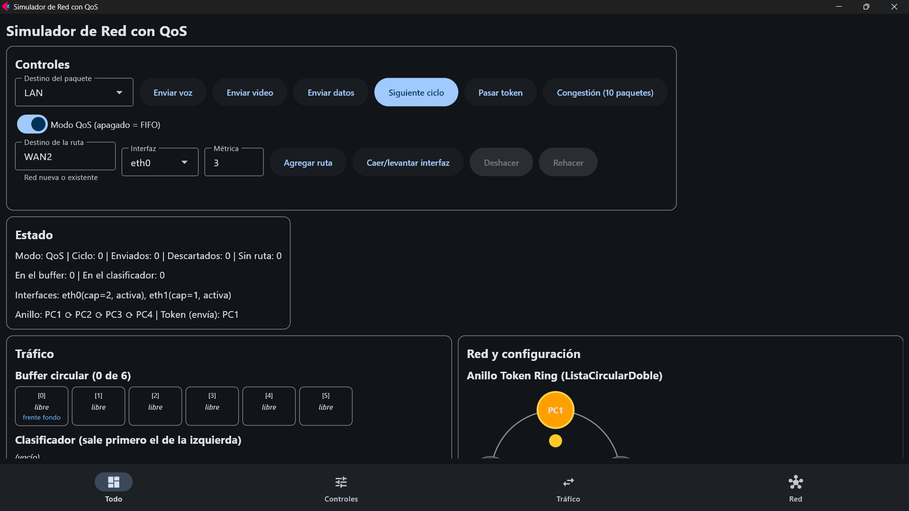

# Simulador de Red con QoS

Proyecto final de **Estructura de Datos I (INF220)** — UAGRM, Facultad de
Ingeniería en Ciencias de la Computación y Telecomunicaciones.

- **Estudiante:** Robert Benancio Garrado Adrián — Reg. 223042714
- **Docente:** Ing. Peinado
- **Carrera:** Ingeniería en Redes y Telecomunicaciones

Simulador de un router que recibe paquetes de **voz, video y datos**, los
guarda en un buffer, los clasifica por prioridad (**QoS**) o por orden de
llegada (**FIFO**) y los despacha por sus interfaces según una tabla de rutas.
Todas las estructuras de datos están **implementadas a mano** con nodos y
punteros, sin usar `list` de Python como almacenamiento en el modelo.

🌐 **Versión web (sin instalar nada):**
https://adricode0101001.github.io/simulador-red/

📄 **Documentación técnica (UML y complejidad):** [DOCUMENTACION.md](DOCUMENTACION.md)



---

## Cómo ejecutarlo

Requisitos: Python 3.12 o superior.

```
pip install -r requirements.txt
```

| Modo | Comando | Dónde se ve |
|---|---|---|
| Escritorio | `python main.py` | Ventana de Windows |
| Navegador local | `python main.py --web` | http://127.0.0.1:8550 |
| Celular (misma Wi-Fi) | `python main.py --red` | http://IP-de-la-PC:8550 |
| Ejecutable | doble clic en `SimuladorRedQoS.exe` | Ventana de Windows, sin Python |
| Web pública | abrir el enlace de arriba | Cualquier navegador o celular |

Pruebas unitarias (101 pruebas):

```
python -m unittest discover tests
```

---

## Las 7 estructuras de datos y dónde se usan

| # | Estructura | Archivo | Uso en el simulador |
|---|---|---|---|
| 1 | Lista simple | `models/listas.py` | Interfaces del router, paquetes que salieron en el ciclo, lote de prueba |
| 2 | Lista doble | `models/listas.py` | Tabla de enrutamiento (navegable en los dos sentidos) |
| 3 | Lista circular doble | `models/listas.py` | Anillo Token Ring: el token gira entre las PCs |
| 4 | Pila | `models/pilas.py` | Encapsulamiento OSI (7 capas, Física en el tope) |
| 5 | Undo/Redo (dos pilas) | `models/pilas.py` | Historial para deshacer y rehacer cambios de configuración |
| 6 | Cola de prioridad | `models/colas.py` | Clasificador QoS: voz (3) > video (2) > datos (1) |
| 7 | Cola circular | `models/colas.py` | Buffer de entrada de tamaño fijo con `%` (única estructura con arreglo fijo, justificado por ser un buffer acotado) |

---

## Arquitectura MVC

```
simulador_red/
├── models/          Estructuras y motor de red (no importa Flet)
│   ├── nodo.py, estructura_base.py, excepciones.py
│   ├── listas.py, pilas.py, colas.py
│   ├── network_engine.py   Paquete, Interfaz, Ruta, Router
│   ├── metricas.py         Espera promedio por tipo de tráfico
│   └── comparador.py       Mismo lote en QoS y en FIFO
├── controllers/
│   └── app_controller.py   Único que conoce al modelo y a la vista
├── views/           Interfaz en Flet (no importa models)
│   ├── vista_principal.py, componentes.py, anillo_visual.py
│   └── panel_metricas.py, panel_comparacion.py
├── tests/           Pruebas unitarias
├── main.py          Punto de entrada
├── demo_estructuras.py       Demostración por consola
└── medicion_complejidad.py   Cronómetro O(1) vs O(n)
```

Flujo: la **vista** recibe el clic → llama al **controlador** → el controlador
modifica el **modelo** → el controlador le pide a la vista que se redibuje con
el estado nuevo.

---

## Funcionalidades

- Envío de paquetes de voz, video y datos desde la PC que tiene el token.
- Ciclo del router en 3 fases: clasificar, despachar y envejecer.
- Modo **QoS** o **FIFO** con un interruptor.
- Tabla de rutas con métrica y **failover** si una interfaz cae.
- Deshacer / rehacer con las dos pilas visibles en pantalla.
- Encapsulamiento OSI paso a paso.
- Anillo Token Ring animado.
- Panel de métricas: espera promedio por tipo, throughput y packet drop.
- **Comparador FIFO vs QoS** con el mismo lote.
- Botón de **congestión** para ver el descarte de paquetes.
- Diseño responsivo con barra de navegación inferior en el celular.

---

## Resultados

### FIFO vs QoS con el mismo lote

Lote: datos, datos, video, datos, voz, voz (3 paquetes por ciclo).

| Espera promedio (ciclos) | QoS | FIFO |
|---|---|---|
| voz | **0.00** | 1.00 |
| video | 0.00 | 0.00 |
| datos | 1.00 | **0.33** |

**Conclusión:** la espera total es la misma en los dos modos. QoS no hace la
red más rápida: le quita la espera a la voz (que no la tolera) y se la pasa a
los datos (que sí la toleran).



### Congestión

Con un buffer de 6 celdas, una ráfaga de 10 paquetes deja entrar 6 y descarta
4 (40 % de pérdida). El descarte ocurre **al entrar** al buffer (tail drop),
antes de que actúe la prioridad.

### O(1) vs O(n) medido

`python medicion_complejidad.py` — tiempo total en milisegundos:

| n | Lista simple, inicio | Lista simple, final | Lista doble, final |
|---|---|---|---|
| 1 000 | 0.8 | 14.7 | 0.3 |
| 2 000 | 0.8 | 71.1 | 1.2 |
| 5 000 | 2.0 | 443.6 | 2.5 |
| 10 000 | 9.7 | 1210.1 | 3.0 |

Insertar al final de la lista simple es O(n) porque recorre toda la lista; en
la lista doble es O(1) gracias al puntero `cola`. Con 10 000 elementos la
diferencia es de unas 400 veces.

---

## Capturas

| Métricas | Anillo Token Ring |
|---|---|
|  |  |

| Celular | Ejecutable de Windows |
|---|---|
|  |  |

---

## Cómo se generaron el ejecutable y la web

Ejecutable de Windows:

```
pip install pyinstaller flet-cli==1.0.3
python -m flet_cli.cli pack main.py --name SimuladorRedQoS --distpath "C:\SimuladorRedQoS"
```

Versión web (se sube al repositorio `simulador-red` con GitHub Pages):

```
python -m flet_cli.cli publish main.py --base-url simulador-red --distpath "C:\simulador-web"
```

Nota: el ejecutable y la web deben generarse en el disco C:, no en una carpeta
sincronizada con Google Drive.